# HomeVault

[](LICENSE)
[](https://go.dev)
[](#16-许可证与致谢)
[](#5-运行环境)

**一个单文件、零第三方依赖、开箱即用的自建网盘。** `go build` 出一个二进制就能跑，不需要数据库、不需要 Node、不需要前端构建，也不要配置文件才能启动。

```bash
go build -o homevault . && ./homevault serve
# 打开 http://127.0.0.1:8080/ ，用 admin / admin 登录（会强制要求改密码）
```

---

## 1. 项目概述

HomeVault 是一个**自托管的私有网盘**：把它跑在自己的小服务器、NAS 或家里的旧电脑上，就能给自己、家人和朋友分配各自独立的存储空间，通过浏览器上传、下载、预览、搜索文件。

### 它解决什么问题

已经有 Nextcloud、Seafile、FileBrowser、Alist 这些成熟的自建网盘，HomeVault 不是要做得比它们功能更多，而是想补上另一头的空白——**"我只想要一个能放心交给家人用、自己维护成本接近零的网盘"**：

| 常见痛点 | HomeVault 的选择 |
| --- | --- |
| Nextcloud 要 PHP + 数据库 + Redis + 一堆扩展，升级还担心弄坏数据 | **只依赖 Go 标准库**，`go build` 不需要联网拉依赖 |
| Seafile 依赖 Python 与 MySQL，还要单独部署文件服务进程 | **前端用 `//go:embed` 直接内嵌进二进制**，没有构建步骤、没有 `node_modules` |
| FileBrowser / Alist 更像"文件管理器"：没有真正的配额、没有回收站保留期、没有审计日志、没有多用户各自的独立空间 | **配额是真会拦上传的**，不是只显示个数字；回收站有保留期；每个动作都有审计留痕 |
| 部分 Go 项目前端要单独 `npm run build`，或引入十几个第三方库 | **元数据用单个 JSON 文件 + 原子替换**，`state.json` 拷走就是完整账号与配置 |
| 部署时要先读半小时文档 | **零配置启动**：第一次运行自动写出 `config.ini` 并创建管理员 |
| 其他项目"配额"只是展示数字 | HomeVault 在**上传、复制、回收站恢复、分片合并**四处都做校验 |

### 适合谁使用

- **个人 / 家庭**：一台闲置小主机或 NAS，给几个人分配独立空间，互不干扰。
- **小团队**：需要审计日志（谁在什么时候传了什么、删了什么）但不想为此部署一整套企业网盘。
- **想彻底掌控数据的人**：所有文件就是磁盘上的普通文件，元数据就是一个 JSON，没有黑盒数据库。
- **愿意做二次开发的开发者**：约 1.2 万行 Go + 原生 ES 模块前端，没有依赖地狱，改完 `go build` 就生效。

---

## 2. 目录

- [1. 项目概述](#1-项目概述)
- [2. 目录](#2-目录)
- [3. 功能特性](#3-功能特性)
- [4. 界面预览](#4-界面预览)
- [5. 运行环境](#5-运行环境)
- [6. 下载与安装](#6-下载与安装)
- [7. 快速启动](#7-快速启动)
- [8. 配置说明](#8-配置说明)
- [9. 使用方法与客户端接入](#9-使用方法与客户端接入)
- [10. 部署与运维](#10-部署与运维)
- [11. 项目目录结构](#11-项目目录结构)
- [12. 开发、编译与测试](#12-开发编译与测试)
- [13. 常见问题与故障排查](#13-常见问题与故障排查)
- [14. 贡献与问题反馈](#14-贡献与问题反馈)
- [15. 版本与更新记录](#15-版本与更新记录)
- [16. 许可证与致谢](#16-许可证与致谢)

---

## 3. 功能特性

### 存储与文件管理

- **多用户独立空间**：每个普通账号有自己的根目录（`files/<root>/`），互不可见；管理员没有自己的存储，只能代操作别人的空间。
- **配额硬限制**：上传、复制、回收站恢复、分片合并四处都校验，超出直接拒绝（HTTP 507），不是只显示个数字。
- **回收站**：删除进回收站而非直接抹掉，可恢复、可彻底删除、可按保留期自动清理；保留期只影响之后被删的文件，缩短不会追溯已有条目。
- **分片上传与续传**：大文件切片上传，同用户 + 同目录 + 同文件名 + 同大小可续传；未完成会话 24 小时后清理。
- **速率限制**：可按账号设置带宽上限（Mbps），`0` 表示不限。
- **搜索与聚合**：跨目录按文件名搜索，一次请求同时返回命中列表与类型、扩展名、体积、按天四组聚合统计。

### 预览与编辑

- **就地预览**：图片、PDF、音视频、文本直接在浏览器里看；Office 文档在完整版镜像下转 PDF 预览。
- **文本在线编辑**：文本文件可在浏览器内编辑并保存，带行号、滚动同步、Tab 缩进处理。
- **目录下钻**：面包屑导航，列表 / 卡片双视图，可按名称、大小、类型、修改时间排序。

### 管理能力

- **管理页面**（`/admin`）：系统概览、用户管理、用户文件代操作、审计日志、存储与运行期设置、关于与帮助。
- **账号与权限**：8 个权限位（读取、上传、修改、删除、查看回收站、管理回收站、用户管理、查看日志）自由组合。
- **管理员二次密码**：所有管理写操作（新建 / 修改 / 删除用户、改设置、清空日志、代操作文件）每次都要重新输入管理员密码，**没有任何免密时间窗**，密码绝不缓存、绝不写 localStorage。
- **审计日志**：每个动作追加写入 `audit/audit-YYYY-MM-DD.jsonl`，可按账号、操作类型、时间范围筛选，支持导出 CSV、清理 60 天前记录。
- **双端严格分离**：管理员账号**不能登录用户端、也没有自己的存储空间**，避免"管理员顺手占用户配额"这类问题。

### 界面与体验

- **原生前端，无需构建**：所有 JS / CSS 通过 `//go:embed all:web` 内嵌进二进制，改前端不用 `npm`，重新 `go build` 即可。
- **完整响应式**：桌面侧边栏导航，移动端自动切成底部标签栏 + 底部抽屉式弹窗（bottom sheet），表格自动变卡片。
- **深色模式**：跟随系统，也可手动切换。
- **无第三方前端依赖**：手写组件库（`web/ui.js`），不加载任何 CDN 资源，离线可用。

### 安全设计

- `argon2` 口令哈希（标准库之外唯一需要自实现的密码学部分，无第三方依赖）。
- 会话存在内存里，**进程重启即全部失效**，必须重新登录。
- 登录失败限流，触发 `429` 并带 `Retry-After`。
- 路径穿越防护、文件名清洗、上传体积上限、同源校验集中在一处实现。

---

## 4. 界面预览

### 管理端 · 系统概览

容量占用、文件类型分布、账号配额一览，一眼看清整体运行状态。

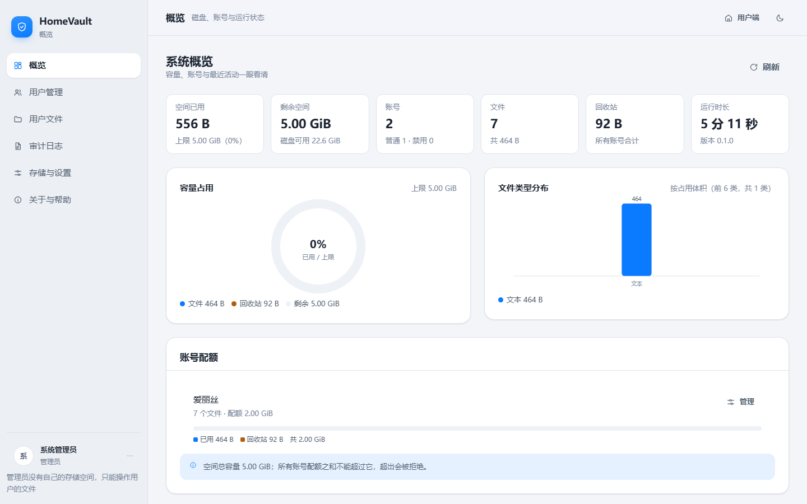

### 管理端 · 用户管理

新建、编辑、禁用、删除账号，直接看到每个账号的配额使用进度与权限位。

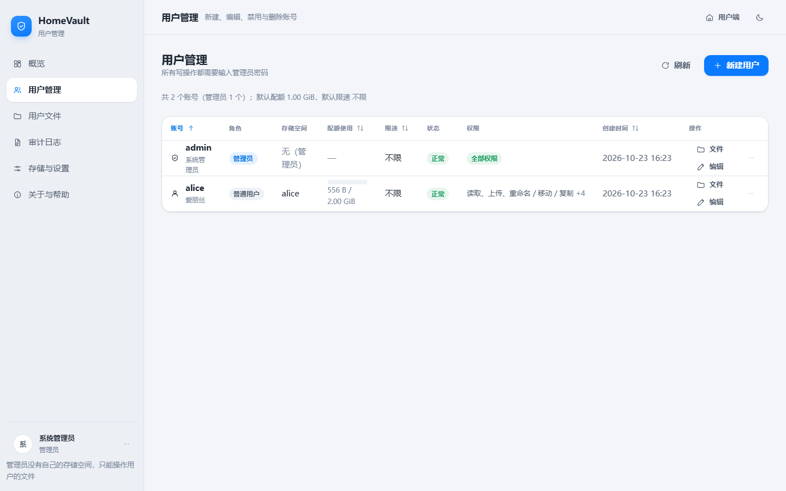

### 管理端 · 审计日志

按账号与操作类型筛选，每一条都记录了谁、什么时候、对什么、成功还是失败。

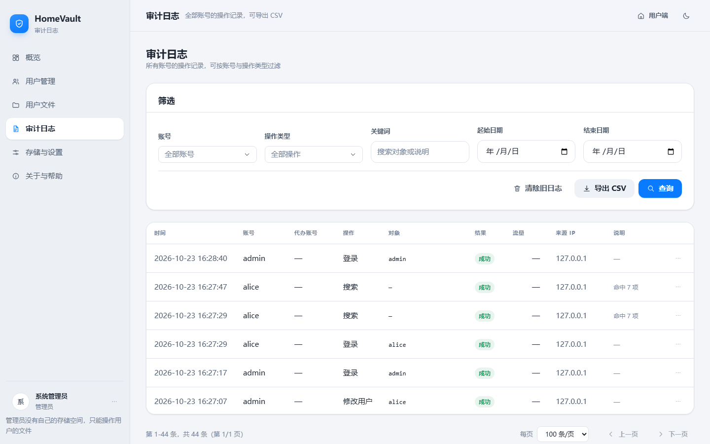

### 管理端 · 用户文件（代操作）

管理员可以进入任意用户的空间代为管理文件，每次写操作都要重新验证管理员密码。

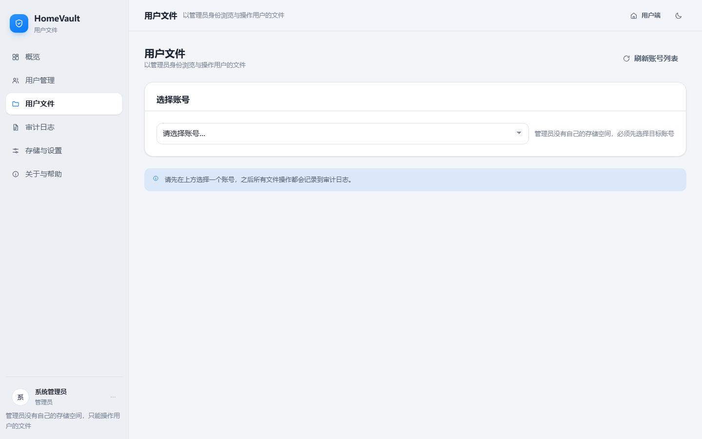

### 用户端 · 我的概览

普通用户看到的容量、文件构成与最近活动。

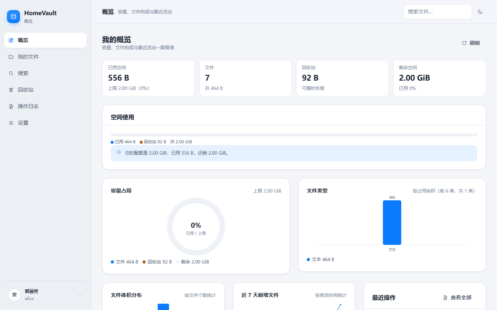

### 用户端 · 我的文件

支持列表 / 卡片双视图、排序、就地筛选、新建文件夹与上传。

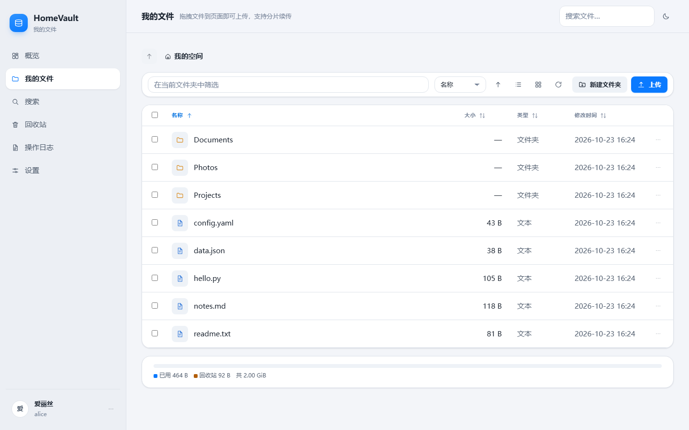

### 用户端 · 文件预览与在线编辑

文本文件可直接在浏览器里阅读和编辑。

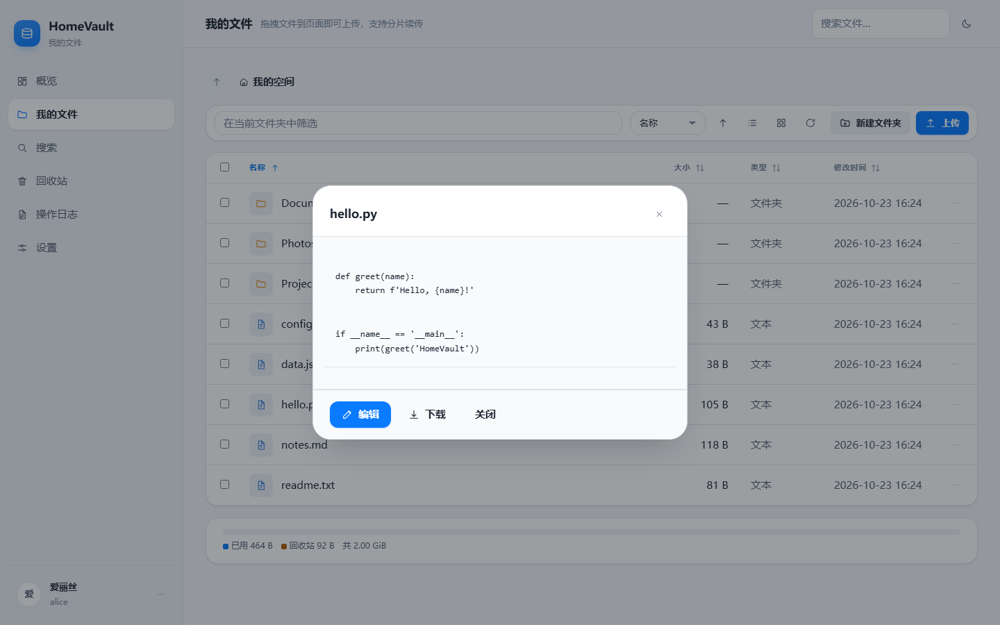

### 用户端 · 回收站

删掉的文件先放这里，可恢复或彻底删除。

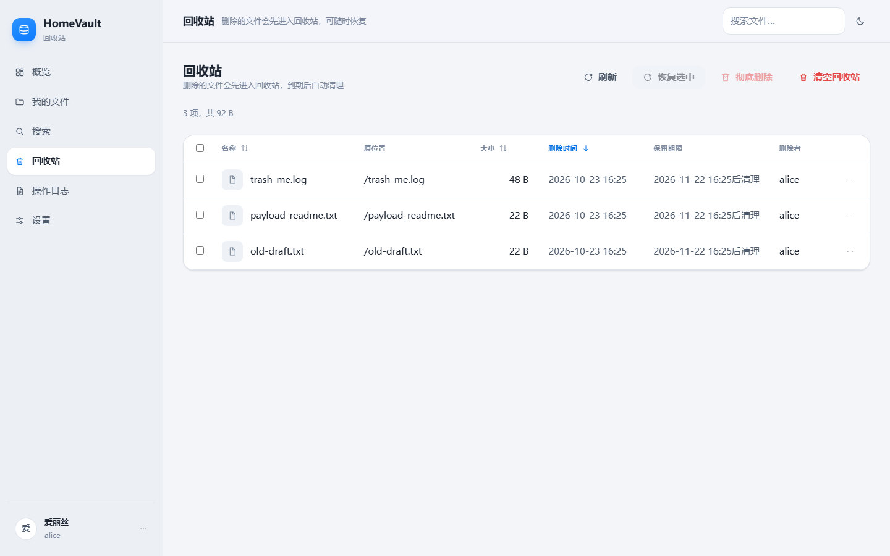

### 用户端 · 设置

查看自己的配额、修改显示名与密码。

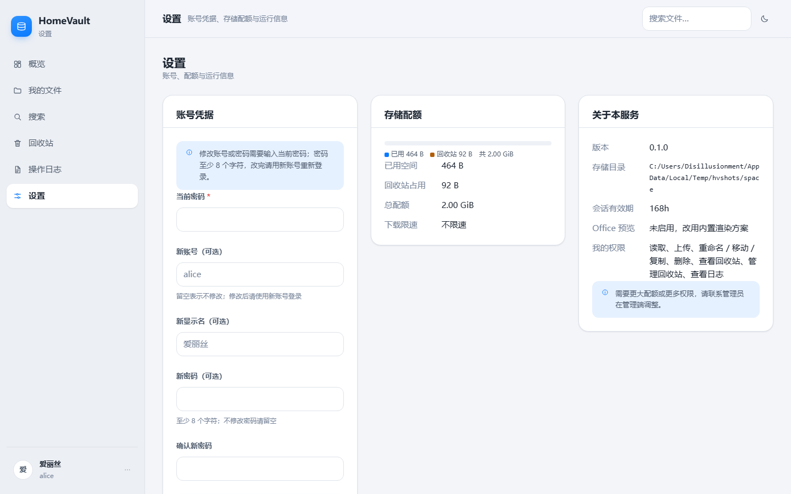

### 用户端 · 操作日志

普通用户能看到自己的操作留痕（需管理员授予"查看日志"权限）。

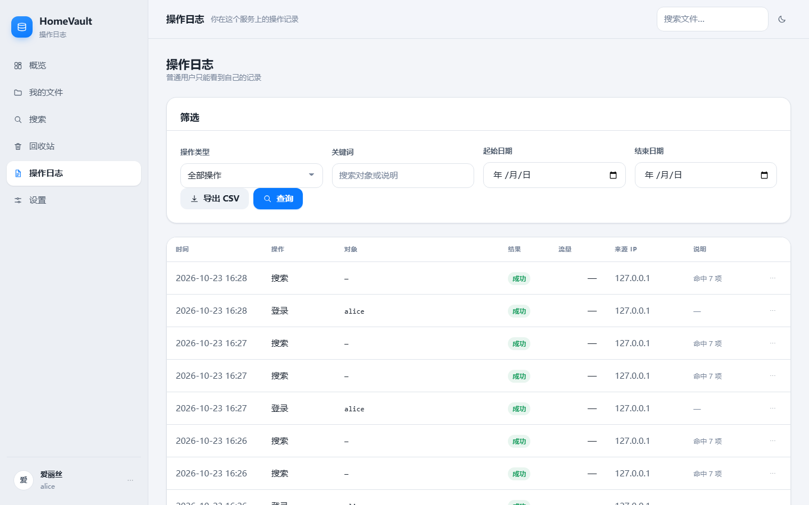

### 移动端适配

手机浏览器上自动切换为底部标签栏导航、卡片式文件列表和底部抽屉弹窗。

<p>
  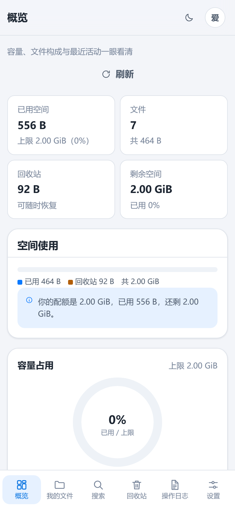
  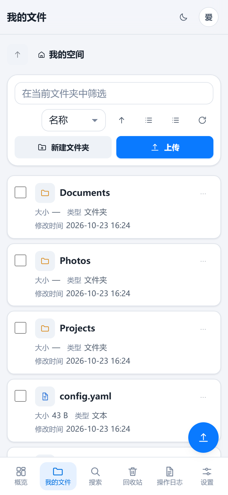
</p>

---

## 5. 运行环境

### 支持的系统与架构

| 操作系统 | 架构 | 运行包文件名 | 说明 |
| --- | --- | --- | --- |
| Windows | x86-64 | `homevault-windows-amd64.zip` | 双击即可运行 |
| Windows | ARM64 | `homevault-windows-arm64.zip` | 适用于 Windows on ARM |
| Linux | x86-64 | `homevault-linux-amd64.tar.gz` | 通用服务器 / VPS |
| Linux | ARM64 | `homevault-linux-arm64.tar.gz` | 树莓派 4/5、ARM 云主机 |
| Linux | ARMv7 | `homevault-linux-armv7.tar.gz` | 树莓派 2/3、老式 ARM 盒子 |
| macOS | Apple Silicon | `homevault-darwin-arm64.tar.gz` | M 系列芯片 |
| macOS | Intel | `homevault-darwin-amd64.tar.gz` | Intel Mac |

所有运行包都是 **`CGO_ENABLED=0` 的静态二进制**，不依赖 libc，因此可以直接跑在 `alpine`、`distroless` 以及任何精简 Linux 发行版上。

### 三种运行方式各自需要什么

| 方式 | 需要准备 | 不需要 |
| --- | --- | --- |
| **直接运行运行包** | 一个对应系统的二进制文件，一个可写目录 | Go 工具链、Node、数据库、配置文件 |
| **源码运行** | **Go 1.24 或更高版本** | Node / npm、C 编译器、任何第三方 Go 依赖 |
| **Docker 部署** | Docker 20.10+（Compose 方式另需 Docker Compose v2） | Go、Node、在宿主机上装任何东西 |

磁盘空间建议：程序本身约 **8 MB**，但要为实际存放的文件预留空间；空间目录需要**可读写**。内存需求很低，几十 MB 即可运行。

---

## 6. 下载与安装

### Release 下载

前往 [Releases](../../releases) 页面，按你的系统挑对应的压缩包。

### 各文件用途

| 文件名 | 用途 |
| --- | --- |
| `homevault-<系统>-<架构>.zip` / `.tar.gz` | **二进制运行包**。解压即得可执行文件，适合不想装 Go 的人 |
| `homevault-<版本>-source.zip` / `.tar.gz` | **源码包**。包含全部 Go 源码与前端资源，适合二次开发或自行编译 |
| `checksums.txt` | 所有发布文件的 SHA-256 校验值，用于验证下载完整性 |

### 如何选择正确的包

1. **先确定系统和架构。** Windows 用户看"设置 → 系统 → 系统类型"；Linux 用户执行 `uname -m`（`x86_64` → amd64，`aarch64` → arm64，`armv7l` → armv7）；macOS 用户执行 `uname -m`（`arm64` → Apple Silicon）。
2. **只想跑起来** → 选二进制运行包。
3. **想改代码 / 自己编译 / 审计源码** → 选源码包。
4. **没有对应架构的包** → 用源码包自己交叉编译，见[第 12 章](#12-开发编译与测试)。

### 验证下载完整性（可选）

```bash
# Linux / macOS
sha256sum -c checksums.txt

# Windows PowerShell
Get-FileHash .\homevault-windows-amd64.zip -Algorithm SHA256
```

---

## 7. 快速启动

### 方式一：Windows 双击启动

1. 下载 `homevault-windows-amd64.zip` 并解压到一个**有写入权限**的目录（例如 `D:\HomeVault`，不要放在 `C:\Program Files`）。
2. 双击 `homevault.exe`。
   > 不带任何参数时等价于 `homevault serve`，会直接启动服务。
3. 第一次运行会自动在当前目录生成 `config.ini`，并在系统默认空间目录（`C:\HomeVaultSpace`）建好数据骨架。
4. 浏览器打开 <http://127.0.0.1:8080/>，用 `admin` / `admin` 登录。
5. **首次登录会强制要求改账号或密码**，改完自动进入管理页面。

> Windows 首次运行时如果弹出防火墙提示，选择"允许访问"（仅本机使用可选"专用网络"）。

### 方式二：Windows 命令行启动

```powershell
# 进入解压目录
cd D:\HomeVault

# 最简：默认监听 0.0.0.0:8080，空间目录用系统默认
.\homevault.exe serve

# 指定配置文件（listen / space_dir 都写在配置文件里）
.\homevault.exe serve -config D:\HomeVault\config.ini

# 调高日志级别排查问题（debug / info / warn / error）
.\homevault.exe serve -log-level debug

# 查看版本
.\homevault.exe version

# 查看全部命令行用法
.\homevault.exe help
```

> `serve` 只接受 `-config` 和 `-log-level` 两个参数。**监听地址和空间目录都通过 `config.ini` 配置**（见[第 8 章](#8-配置说明)），没有 `-listen` / `-space` 之类的命令行参数——改完配置文件后重启进程生效。

### 方式三：Linux 二进制启动

```bash
# 下载并解压
tar -xzf homevault-linux-amd64.tar.gz
cd homevault-linux-amd64

# 赋予执行权限
chmod +x homevault

# 前台启动
./homevault serve

# 或指定配置文件
./homevault serve -config /etc/homevault/config.ini

# 排查问题时打开 debug 日志
./homevault serve -log-level debug
```

长期运行时，空间目录请写在 `config.ini` 的 `space_dir` 里（如 `/var/lib/homevault`），然后重启进程。作为系统服务运行见[第 10 章](#10-部署与运维)。

### 方式四：从源码运行

```bash
# 1) 确认 Go 版本 ≥ 1.24
go version

# 2) 进入源码目录（不需要 go mod download，本项目零依赖）
cd HomeVault

# 3) 直接运行
go run . serve

# 或先编译再运行
go build -o homevault .
./homevault serve
```

Windows 上把 `./homevault` 换成 `.\homevault.exe`。

### 方式五：Docker

```bash
# 精简版（推荐，镜像约 25–40 MB）
docker run -d \
  --name homevault \
  -p 8080:8080 \
  -v /srv/homevault/space:/data \
  --restart unless-stopped \
  homevault:lite

# 完整版（约 700 MB–1 GB，额外带 LibreOffice，支持 Office 转 PDF 预览）
docker run -d \
  --name homevault-full \
  -p 8080:8080 \
  -v /srv/homevault/space:/data \
  --restart unless-stopped \
  homevault:full
```

也可以直接用仓库里的 `deploy/Dockerfile.lite` / `deploy/Dockerfile.full` 自行构建：

```bash
docker build -f deploy/Dockerfile.lite -t homevault:lite .
docker build -f deploy/Dockerfile.full -t homevault:full .
```

### 方式六：Docker Compose

仓库提供了 `deploy/docker-compose.yml`：

```bash
cd deploy
docker compose up -d

# 查看日志
docker compose logs -f

# 停止
docker compose down
```

`docker-compose.yml` 里已经把空间目录挂载到宿主机、设置了 `restart` 策略。**修改任何配置后需要 `docker compose up -d` 重建容器**（`restart` 不会重新读取挂载或环境变量变更）。

> 完整的环境变量、端口、卷说明见 [`docs/DEPLOY.md`](docs/DEPLOY.md)。

---

## 8. 配置说明

### 配置文件位置与创建方法

HomeVault **不需要配置文件就能启动**。配置文件只在需要改监听地址、空间目录、TLS 或首次管理员账号时才用得上。

- **位置**：默认读取**当前工作目录**下的 `config.ini`；也可以用 `-config` 指定任意路径。
- **创建方法**：第一次启动时，如果目标路径上没有 `config.ini`，程序会自动写出一份带注释的模板。也可以手动新建。

> ⚠️ **配置文件必须是 UTF-8 无 BOM 编码。** 用记事本另存为时请选"UTF-8"而不是"UTF-8 with BOM"，否则会报 `第 1 行：未知配置项 "\ufefflisten"`。

### 完整示例

```ini
# HTTP(S) 监听地址。放在反向代理后面时建议改成 127.0.0.1:8080。
listen = "0.0.0.0:8080"

# 空间目录：用户文件、回收站、审计日志、上传分片、缓存与元数据都在其中。
space_dir = "D:/HomeVaultSpace"

# 同时设置下面两项才启用内置 HTTPS；否则建议由反向代理（Caddy / Nginx）终结 TLS。
tls_cert = ""
tls_key = ""

# 首次启动创建管理员用。默认 admin / admin，登录后会强制要求改账号或密码。
# 只有第一次启动（空间目录里还没有 state.json）时读取这两项。
admin_user = "admin"
admin_password = "改成你自己的强密码"
```

### 字段说明

| 字段 | 类型 | 默认值 | 必填 | 说明 |
| --- | --- | --- | --- | --- |
| `listen` | string | `"0.0.0.0:8080"` | 否 | HTTP(S) 监听地址。反向代理后面建议 `"127.0.0.1:8080"` |
| `space_dir` | string | 系统默认 | 否 | 空间目录绝对路径。**必须是绝对路径**，否则启动失败；相对路径按配置文件所在目录解析 |
| `tls_cert` | string | `""` | 否 | TLS 证书路径（PEM）。必须与 `tls_key` 同时非空才启用内置 HTTPS |
| `tls_key` | string | `""` | 否 | TLS 私钥路径（PEM） |
| `admin_user` | string | `"admin"` | 否 | **只在首次启动创建管理员时读取**，之后改这里不会改动已有账号 |
| `admin_password` | string | `"admin"` | 否 | 同上。首次启动用它生成密码哈希；之后改这里**不会**改密码 |

### 必填项

**没有必填项。** 所有字段都有可用默认值，不做任何配置也能跑起来。

`space_dir` 一旦填写就必须是**绝对路径**，这是唯一会因格式导致启动失败的限制。

### 哪些修改需要重启

| 修改内容 | 是否需重启 |
| --- | --- |
| `config.ini` 里的**任何字段**（`listen`、`space_dir`、TLS、管理员账号） | **需要重启进程** |
| 管理页面「存储与设置」里的运行期参数（默认配额、默认限速、回收站保留期、上传体积上限等） | **不需要**，保存后立即生效 |

运行期参数只影响**之后新建的账号**或**之后被删除的文件**，不会追溯改动已有数据。

### 空间目录内部结构

```
<space_dir>/
├── state.json           # 全部账号与配置（单文件 + 原子替换）
├── files/<root>/        # 每个用户的实际文件
├── trash/<id>/payload   # 回收站条目
├── audit/audit-*.jsonl  # 审计日志，每天一个文件
├── uploads/             # 分片上传临时区
└── cache/office/        # Office 预览转换缓存，可随时删
```

> 完整字段、环境变量与迁移说明见 [`docs/CONFIG.md`](docs/CONFIG.md)。

---

## 9. 使用方法与客户端接入

### 管理页面登录

1. 浏览器打开 `http://<你的地址>:8080/admin`。
2. 用 `config.ini` 里的 `admin_user` / `admin_password` 登录（默认 `admin` / `admin`）。
3. 首次登录会强制要求改账号或密码，**改完才能进管理页面**。
4. 登录后左侧是六个页面：概览、用户管理、用户文件、审计日志、存储与设置、关于与帮助。

> **管理员账号不能登录用户端，也没有自己的存储空间。** 管理员访问 `/` 会看到一段说明和"前往管理端"的入口；需要操作文件时请到「用户文件」页选择目标账号代操作。

### 用户端登录

普通用户访问 `http://<你的地址>:8080/`，用管理员分配的账号密码登录，看到的是自己的空间。

### 创建新用户

管理端「用户管理」→「新建用户」，需要填：

| 字段 | 说明 |
| --- | --- |
| 用户名 / 密码 | 密码 8–200 字符 |
| 显示名 | 可选，用于界面展示 |
| 根目录 | 该用户的存储根（不同用户不要共用） |
| 配额 | 字节数，例如 2 GiB = `2147483648` |
| 速率限制 | Mbps，`0` 表示不限 |
| 权限 | 勾选该账号能做什么 |

### Base URL 与鉴权方式

| 项目 | 值 |
| --- | --- |
| Base URL | `http://<你的地址>:8080` |
| 管理端页面 | `/admin` |
| 用户端页面 | `/` |
| 鉴权方式 1 | **Cookie**：登录后浏览器自动携带 `Cookie: homevault_session=<token>` |
| 鉴权方式 2 | **请求头**：`Authorization: Bearer <token>` |
| 二次密码（管理写操作） | 请求体 `adminPassword` 字段，或请求头 `X-LD-Password` / `X-LD-Password-B64` |

### 登录并取得 token

```bash
curl -i -X POST http://127.0.0.1:8080/api/auth/login \
  -H 'Content-Type: application/json' \
  -d '{"username":"alice","password":"你的密码"}'
```

响应头里的 `Set-Cookie: homevault_session=...` 就是会话凭据。**登录响应体里只有 `user` 和 `home`，不单独返回 `token` 字段**——要做 Bearer 鉴权的话，把 Cookie 里 `homevault_session` 的值取出来当 token 用：

```bash
TOKEN='YWxpY2UK...'   # 上一步 Set-Cookie 里 homevault_session 的值
curl "http://127.0.0.1:8080/api/auth/me" -H "Authorization: Bearer $TOKEN"
```

### 上传文件

小文件走 multipart（**注意：目标目录是 query 参数 `path`，不是请求体字段**）：

```bash
curl -X POST "http://127.0.0.1:8080/api/fs/upload?path=Documents" \
  -H "Cookie: homevault_session=<你的 token>" \
  -F "file=@./report.pdf"
```

大文件建议走分片接口 `POST /api/upload/init` → `PUT /api/upload/{id}/{index}` → `POST /api/upload/{id}/complete`，支持断点续传。

### 列出目录与下载

```bash
# 列目录
curl "http://127.0.0.1:8080/api/fs/list?path=" \
  -H "Cookie: homevault_session=<你的 token>"

# 下载
curl -OJ "http://127.0.0.1:8080/api/fs/download?path=Documents/report.pdf" \
  -H "Cookie: homevault_session=<你的 token>"
```

### 搜索

```bash
curl "http://127.0.0.1:8080/api/search?q=report&limit=20" \
  -H "Cookie: homevault_session=<你的 token>"
```

返回值除命中列表外，还带 `byKind` / `byExt` / `bySize` / `byDay` 四组聚合统计。

### 客户端兼容性

HomeVault 提供标准 HTTP + JSON 接口和浏览器页面，**不提供 WebDAV / S3 / FTP 兼容协议**；第三方客户端需要按 HTTP 接口自行对接。

> 完整的接口清单、请求体字段、错误码说明见 [`docs/API.md`](docs/API.md)。

---

## 10. 部署与运维

### 监听地址与端口

- 默认 `0.0.0.0:8080`，即监听所有网卡的 8080 端口。
- 只在本机反代后面跑时，应改成 `127.0.0.1:8080`，避免直接暴露到公网。
- 改端口改 `config.ini` 的 `listen` 后**需要重启**。

### 后台运行

**Linux（systemd，推荐）**

仓库提供了 `deploy/litedrive.service` 作为模板：

```bash
sudo cp deploy/litedrive.service /etc/systemd/system/homevault.service
sudo systemctl daemon-reload
sudo systemctl enable --now homevault
sudo systemctl status homevault
```

**Linux（nohup 临时跑）**

```bash
nohup ./homevault serve > homevault.log 2>&1 &
```

**Windows**

作为计划任务运行，或用 [NSSM](https://nssm.cc/) 把 `homevault.exe serve` 注册成服务。

### 容器数据挂载与持久化

**唯一需要持久化的是空间目录**（`space_dir`）。它包含用户文件、回收站、审计日志和 `state.json`，**不挂载就会在容器删除时丢数据**。

```bash
-v /srv/homevault/space:/data
```

`state.json` 是全部账号与配置，**单独备份它就等于备份了完整账号体系**；用户文件在 `files/` 下是普通文件，任何备份工具都能处理。

### 停止与重启

```bash
# systemd
sudo systemctl stop homevault
sudo systemctl restart homevault

# Docker
docker stop homevault && docker start homevault

# 前台运行时直接 Ctrl+C（会优雅关闭）
```

> **重要：进程重启会让所有会话失效**（会话存在内存里），所有用户都需要重新登录。升级前请提前告知使用者。

### 升级

1. **先备份空间目录**（至少备份 `state.json`）。
2. 停止旧进程。
3. 用新二进制替换旧二进制。
4. 启动并访问 `/api/healthz` 确认健康。
5. 用浏览器强制刷新（`Ctrl + Shift + R`）清掉前端缓存。

空间目录格式向后兼容，一般不需要迁移。如果新版本改了目录结构，会在 Release 说明里给出 `homevault migrate-space` 的用法。

### 健康检查

```bash
curl -f http://127.0.0.1:8080/api/healthz
```

返回 2xx 即表示服务正常。可接入 systemd watchdog 或容器 healthcheck。

### 迁移空间目录

```bash
# 把整个空间目录搬到新位置
./homevault migrate-space --to /new/path/to/space
```

搬完后记得同步修改 `config.ini` 的 `space_dir` 并重启。

> 反向代理、TLS、备份策略的完整示例见 [`docs/DEPLOY.md`](docs/DEPLOY.md) 和 [`docs/UPGRADE_BACKUP.md`](docs/UPGRADE_BACKUP.md)。

---

## 11. 项目目录结构

```
HomeVault/
├── main.go                  # 程序入口：子命令解析、HTTP 服务启动、优雅关闭、//go:embed 前端
├── go.mod                   # 模块声明（零第三方依赖，无 go.sum）
├── build.ps1                # 跨平台交叉编译脚本
├── deploy/                  # 部署相关模板
│   ├── Dockerfile.lite      # 精简镜像（约 25–40 MB）
│   ├── Dockerfile.full      # 完整镜像（带 LibreOffice）
│   ├── docker-compose.yml   # Compose 编排
│   ├── Caddyfile            # Caddy 反代示例
│   ├── nginx.conf           # Nginx 反代示例
│   ├── litedrive.service    # systemd 单元模板
│   └── env.example          # 环境变量示例
├── docs/                    # 详细文档
│   ├── API.md               # 完整 HTTP 接口参考（请求体、错误码）
│   ├── CONFIG.md            # 配置项与运行期设置完整说明
│   ├── DEPLOY.md            # 部署、反代、TLS、容器
│   ├── UPGRADE_BACKUP.md    # 升级与备份策略
│   ├── README-legacy.md     # 早期开发阶段的说明（保留供参考）
│   └── images/              # README 用的界面截图
├── internal/                # 全部业务逻辑（Go 内部包，外部不可导入）
│   ├── audit/               # 审计日志：JSONL 追加写、按天分文件、保留期清理
│   ├── auth/                # 口令哈希、会话管理、登录限流
│   ├── config/              # config.ini 解析、默认值、模板生成
│   ├── core/                # 核心业务：空间服务、搜索聚合、预览转换
│   ├── fsops/               # 底层文件操作：路径校验、文件名清洗、原子写、临时文件
│   ├── server/              # HTTP 层：路由表、各接口 handler、中间件、磁盘信息
│   └── state/               # 元数据状态：账号、权限、设置、state.json 原子持久化
└── web/                     # 前端（原生 ES 模块，全部内嵌进二进制）
    ├── index.html           # 用户端页面外壳
    ├── admin.html           # 管理端页面外壳
    ├── ui.js                # 手写组件库 + API 客户端 + 上传管理器
    ├── app.js               # 用户端路由与页面
    ├── admin.js             # 管理端路由与页面
    ├── style.css            # 全部样式（含响应式与深色模式）
    └── icons.svg            # 内联 SVG 图标精灵
```

### 各目录职责要点

| 目录 | 职责 | 改动影响 |
| --- | --- | --- |
| `main.go` | 启动流程、子命令、`//go:embed all:web` 挂载前端 | 改前端后需重新编译 |
| `internal/server/` | 路由表（`server.go` 里的 `[]routeSpec`）、全部 HTTP handler | 加接口改这里 |
| `internal/core/` | 与 HTTP 无关的业务规则：配额判定、搜索聚合、预览 | 业务逻辑主战场 |
| `internal/state/` | 账号 / 权限 / 设置的数据模型与持久化 | 加字段改这里 |
| `internal/fsops/` | 所有直接碰文件系统的底层操作 | 安全相关的关键位置 |
| `internal/auth/` | 密码学与会话 | 谨慎修改 |
| `web/` | 全部前端，无构建步骤 | 改完重新 `go build` 即生效 |

---

## 12. 开发、编译与测试

### 开发环境准备

| 需要 | 版本 | 说明 |
| --- | --- | --- |
| **Go** | **1.24+** | 唯一必需项 |
| Git | 任意较新版本 | 克隆仓库 |
| 编辑器 | 任意 | VS Code / GoLand / Vim 都行 |

**不需要** Node、npm、C 编译器、数据库或任何第三方 Go 依赖——`go build` 全程不联网。

```bash
git clone <仓库地址>
cd HomeVault
go version    # 确认 ≥ 1.24
```

### 编译命令

```bash
# 本机平台编译（最常用）
go build -o homevault .

# Windows
go build -o homevault.exe .

# 带体积优化的发布构建
CGO_ENABLED=0 go build -trimpath -ldflags "-s -w" -o homevault .

# 交叉编译示例
CGO_ENABLED=0 GOOS=linux   GOARCH=arm64 go build -trimpath -ldflags "-s -w" -o homevault-linux-arm64 .
CGO_ENABLED=0 GOOS=darwin  GOARCH=arm64 go build -trimpath -ldflags "-s -w" -o homevault-darwin-arm64 .
CGO_ENABLED=0 GOOS=windows GOARCH=amd64 go build -trimpath -ldflags "-s -w" -o homevault-windows-amd64.exe .
```

一键编译全部平台（PowerShell）：

```powershell
pwsh -File .\build.ps1

# 只编译指定平台
pwsh -File .\build.ps1 -Targets linux/amd64,linux/arm64

# 自定义输出目录
pwsh -File .\build.ps1 -OutDir out
```

产物会写到 `dist/` 目录。

### 修改前端后的处理方式

**前端没有构建步骤，也没有热更新。** 前端文件通过 `//go:embed all:web` 编译进二进制，所以：

```bash
# 改完 web/*.js 或 web/*.css 后，重新编译即可
go build -o homevault . && ./homevault serve
```

浏览器端还要**强制刷新（`Ctrl + Shift + R`）**，否则可能读到旧缓存。

### 测试

```bash
# 全部测试
go test ./...

# 详细输出
go test -v ./...

# 指定包
go test ./internal/core/

# 跳过缓存重新跑
go test -count=1 ./...

# 覆盖率
go test -cover ./...
go test -coverprofile=coverage.out ./... && go tool cover -html=coverage.out
```

测试覆盖口令哈希与登录限流、路径穿越防护、配额拒绝、回收站生命周期、分片上传、权限位隔离、审计留痕等关键路径。

### 格式与静态检查

```bash
# 格式检查（应当输出为空）
gofmt -l .

# 自动格式化
gofmt -w .

# 静态检查
go vet ./...
```

---

## 13. 常见问题与故障排查

### 缺少配置文件 / 配置报错

**症状**：启动即退出，提示 `第 1 行：未知配置项 "\ufefflisten"`。

**原因**：`config.ini` 带 UTF-8 BOM（记事本另存为"UTF-8 with BOM"会导致）。

**处理**：用编辑器另存为**无 BOM 的 UTF-8**。VS Code 右下角可直接切换编码为 "UTF-8"（不是 "UTF-8 with BOM"）。

---

**症状**：`space_dir 必须是绝对路径`。

**处理**：`space_dir` 填写完整绝对路径，如 `D:/HomeVaultSpace` 或 `/var/lib/homevault`。

---

**症状**：找不到配置文件但服务却能启动。

**说明**：这是正常的。**没有配置文件也能运行**，程序会使用全部默认值（`0.0.0.0:8080` + 系统默认空间目录）。

### 端口被占用

**症状**：`bind: address already in use`。

**排查**：

```bash
# Linux / macOS
sudo lsof -i :8080
ss -tlnp | grep 8080

# Windows
netstat -ano | findstr :8080
```

**处理**：结束占用进程，或改 `config.ini` 的 `listen` 换一个端口。

### 鉴权失败

| 症状 | 原因 | 处理 |
| --- | --- | --- |
| 刚重启就被踢下线，全部 `401` | **会话存在内存里，重启即清空** | 重新登录。这是设计行为 |
| `403 invalid_password` | 管理员二次密码输错了 | 重新输入。多次失败会触发 `429` |
| `428 reauth_required` | 写操作没带 `adminPassword` | 补上请求体 `adminPassword` 或 `X-LD-Password` 头 |
| `429 too_many_attempts` | 登录失败次数过多 | 等待 `Retry-After` 指定的秒数再试 |
| 管理员登录用户端被拒 | **管理员没有个人空间** | 用管理端 `/admin`，或到「用户文件」代操作 |

### 文件请求失败

| 症状 | 原因 | 处理 |
| --- | --- | --- |
| 上传返回 `507` | 配额不足 | 清理回收站、删除文件，或让管理员提高配额 |
| 上传返回 `413` | 超过单次上传体积上限 | 走分片上传接口，或让管理员调高上限 |
| 下载 `404` | 路径不存在，或不在自己根目录内 | 检查 `path` 参数；跨用户访问会被拒绝 |
| 大文件上传中断 | 网络抖动 | 用分片接口续传（同用户+同目录+同文件名+同大小会自动复用会话） |

### 异常退出

**排查顺序**：

1. **看日志**：前台运行时错误直接打印到 stderr；systemd 用 `sudo journalctl -u homevault -n 200 --no-pager`；Docker 用 `docker logs --tail 200 homevault`。
2. **看审计日志**：`<space_dir>/audit/audit-YYYY-MM-DD.jsonl`，每天一个文件，记录了每个动作及其成败。
3. **检查磁盘**：空间不足会导致写入失败。`df -h`（Linux）/ 资源管理器（Windows）。
4. **检查权限**：进程对 `space_dir` 必须有读写权限。Linux 下注意 systemd 单元里的 `User=` 与目录属主是否一致。
5. **检查 `state.json` 是否损坏**：它采用"临时文件 → fsync → rename"的原子替换，理论上不会写坏；若确实损坏，从备份恢复即可。

### 日志位置速查

| 日志 | 位置 |
| --- | --- |
| 进程运行日志（stderr） | 前台：终端；systemd：`journalctl -u homevault`；Docker：`docker logs homevault` |
| 审计日志（业务动作） | `<space_dir>/audit/audit-YYYY-MM-DD.jsonl` |
| 前端错误 | 浏览器开发者工具 Console |

### 界面看起来没变化

**原因**：浏览器缓存了旧的 JS / CSS。

**处理**：`Ctrl + Shift + R`（macOS：`Cmd + Shift + R`）强制刷新。

### 移动端显示异常

**说明**：窗口宽度小于 860px 时自动切换移动布局（底部标签栏 + 卡片列表 + 底部抽屉弹窗）。桌面浏览器窗口拖得很窄也会触发，属于预期行为。

### Office / PDF / 图片预览显示"拒绝连接"或被浏览器拦截

**原因**：预览是通过 `<iframe>` 加载的，如果响应头禁止嵌入，浏览器会直接拒绝渲染。

服务端对预览类接口（`/api/preview`、`/api/preview/office`、`/api/fs/download`）返回 `X-Frame-Options: SAMEORIGIN`，允许本站内嵌；其他页面返回 `DENY` 防点击劫持。

**排查顺序**：

1. **先确认是不是端口写错了。** 浏览器里访问 `http://IP` 默认走 80 端口，而服务默认监听 8080（Docker 场景常映射到别的端口，如 18090）。用 `http://IP:端口` 访问。
2. 换一个浏览器或无痕窗口，排除扩展拦截（广告拦截类插件会拦 iframe）。
3. 确认前面没有额外的反向代理覆盖这两个响应头。Nginx 里如果配了 `add_header X-Frame-Options DENY;`，会与首页的 CSP 冲突，需要针对预览路径放开。

**如果 Office 预览提示"服务端未安装 LibreOffice"**：说明当前是 lite 版镜像。Office 转 PDF 需要 full 版（内置 LibreOffice，镜像约 700 MB – 1 GB）。

---

## 14. 贡献与问题反馈

### 提交 Issue

提 Issue 前请先搜索是否已有相同问题。建议包含：

| 需要提供 | 说明 |
| --- | --- |
| **HomeVault 版本** | `./homevault version` 的输出 |
| **操作系统与架构** | 如 `Ubuntu 22.04 / amd64`、`Windows 11 / x64`、`群晖 DSM 7 / arm64` |
| **运行方式** | 二进制直跑 / systemd / Docker（哪个镜像） |
| **复现步骤** | 从登录开始的完整操作路径 |
| **预期 vs 实际** | 你期望发生什么，实际发生了什么 |
| **错误信息** | HTTP 状态码 + 响应体 JSON，或后台 stderr 的关键几行 |
| **审计日志片段** | 相关时间段的 `audit-*.jsonl` 行（**请先脱敏密码与私密文件名**） |

> ⚠️ **提交前务必删除密码、token、内网 IP、真实文件内容等隐私信息。**

### 反馈故障需要哪些信息

最小可用故障报告 = **版本 + 系统架构 + 运行方式 + 复现步骤 + 错误原文**。缺任何一项都会显著拉长排查时间。

如果是"某个接口返回异常"，附上 `curl -i` 的完整请求与响应（把 Cookie 换成 `<REDACTED>`）。

### 如何参与二次开发

1. **Fork 仓库并克隆到本地。**
2. **创建分支**：`git checkout -b feature/your-feature`。
3. **遵守现有约定**：
   - 后端：保持**零第三方依赖**（引入任何外部包都会被拒绝）；新接口加在 `internal/server/server.go` 的路由表里。
   - 前端：保持**无构建步骤**，不引入框架、不使用 CDN、不引入打包工具；新样式用已有的 `--ld-*` CSS 变量。
   - 保留既有 CSS 类名与 JS 组件契约，不要重命名公开的 class / prop。
4. **补测试**：业务逻辑改动请在对应包的 `*_test.go` 里加用例。
5. **过检查**：`gofmt -l .` 输出为空、`go vet ./...` 无报错、`go test ./...` 全绿。
6. **提 Pull Request**，说明改了什么、为什么改、怎么验证的。

### 开发时的硬约束

| 约束 | 原因 |
| --- | --- |
| 不加第三方 Go 依赖 | 保证 `go build` 不联网、供应链攻击面最小 |
| 前端不引入构建工具 | 保证前端能 `//go:embed` 直接内嵌、改完 `go build` 即生效 |
| 不用数据库 | 元数据单文件 JSON + 原子替换，备份就是拷文件 |
| 管理写操作必须二次密码 | 不做免密时间窗，避免提权后门 |

---

## 15. 版本与更新记录

### 当前版本

**`0.1.0`**

查看方式：

```bash
./homevault version
```

管理页面「关于与帮助」也会显示当前版本与运行时信息。

### 0.1.0 主要能力

首个可用版本，包含：

- 多用户独立空间、配额硬限制、回收站与保留期、分片上传续传、速率限制
- 文件预览（图片 / PDF / 音视频 / 文本 / Office 转 PDF）与文本在线编辑
- 管理端：系统概览、用户管理、用户文件代操作、审计日志、运行期设置
- 8 个权限位组合、管理员二次密码、双端严格分离、登录限流
- 完整响应式界面（桌面侧边栏 / 移动底部标签栏）与深色模式
- 客户端独立「概览」页：容量、文件构成、体积分布、近 7 天趋势、最近操作

### 更新入口

- **Release 说明**：[Releases](../../releases) 页面，每个版本都附带变更摘要与升级注意事项
- **升级指南**：[`docs/UPGRADE_BACKUP.md`](docs/UPGRADE_BACKUP.md)（含备份与回滚步骤）

> 升级前请务必备份空间目录，尤其是 `state.json`。

---

## 16. 许可证与致谢

### 许可证

本项目以 **GNU General Public License v3.0（GPL-3.0）** 发布。完整条款见仓库根目录的 [`LICENSE`](LICENSE) 文件。

```
Copyright (C) 2026 MDDC0412

This program is free software: you can redistribute it and/or modify
it under the terms of the GNU General Public License as published by
the Free Software Foundation, either version 3 of the License, or
(at your option) any later version.

This program is distributed in the hope that it will be useful,
but WITHOUT ANY WARRANTY; without even the implied warranty of
MERCHANTABILITY or FITNESS FOR A PARTICULAR PURPOSE.  See the
GNU General Public License for more details.

You should have received a copy of the GNU General Public License
along with this program.  If not, see <https://www.gnu.org/licenses/>.
```

**简单说**：

| 你可以 | 你需要 |
| --- | --- |
| 自由使用、修改、分发本项目（包括商用） | 分发时附带许可证全文并公开源码 |
| 把它部署在自己的服务器上，不需要公开任何东西 | 修改后的版本若对外分发，也要以 GPL-3.0 授权 |
| 基于它做自己的项目 | 保留版权声明与免责声明，且不为原作者提供担保 |

> **只在内部使用（比如部署给自己和家人用）不触发任何开源义务。** GPL 的约束从"对外分发"开始。

### 第三方组件

**运行时零第三方依赖。** `go.mod` 中没有任何 `require` 条目，仓库里没有 `go.sum`，前端不加载任何 CDN 资源或 npm 包。

使用的全部能力都来自 **Go 标准库**（`net/http`、`embed`、`encoding/json`、`crypto/*`、`os`、`path/filepath` 等）。

### 致谢

- **Go 团队**：标准库的成熟度让"零依赖"这个选择成为可能——`net/http`、`embed`、`crypto` 基本覆盖了自建网盘的全部需要。
- **自由软件基金会**：GPL-3.0 许可证文本与它所代表的软件自由理念。
- **所有使用并反馈问题的用户**：真实使用场景里的问题反馈是这个项目还能继续改进的唯一原因。

---

## 文档索引

| 文档 | 内容 |
| --- | --- |
| [`docs/API.md`](docs/API.md) | 完整 HTTP 接口参考：路径、请求体字段、错误码 |
| [`docs/CONFIG.md`](docs/CONFIG.md) | 配置项与运行期设置的完整说明 |
| [`docs/DEPLOY.md`](docs/DEPLOY.md) | 部署、反向代理、TLS、容器化 |
| [`docs/UPGRADE_BACKUP.md`](docs/UPGRADE_BACKUP.md) | 升级流程与备份策略 |
